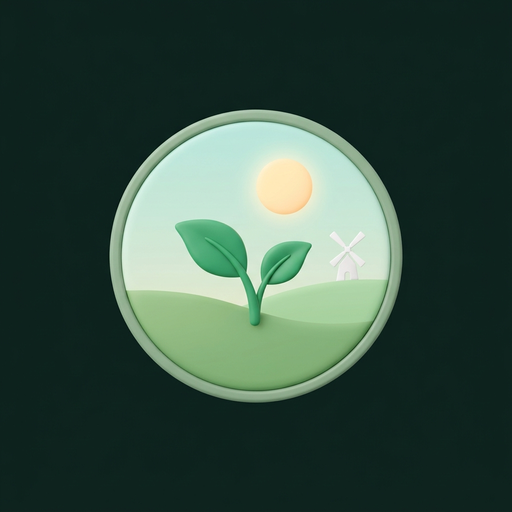
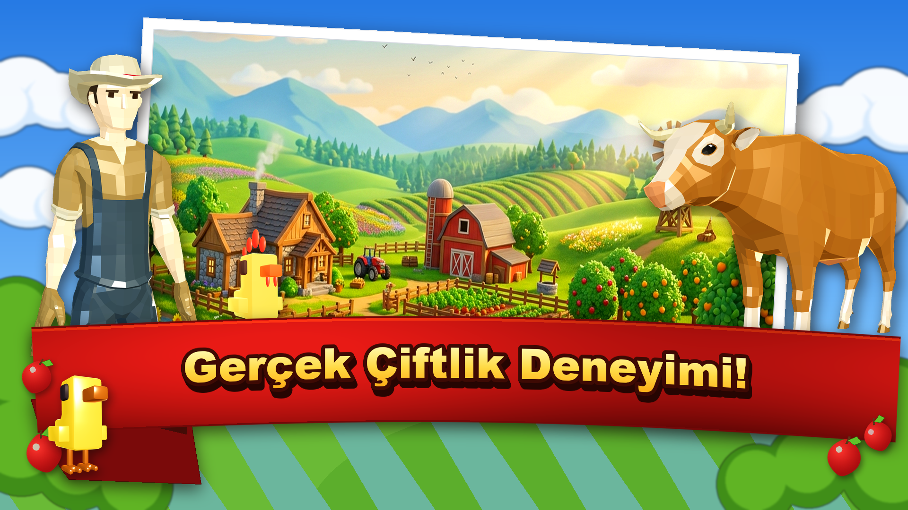
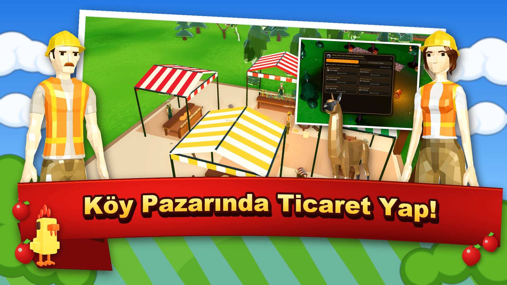
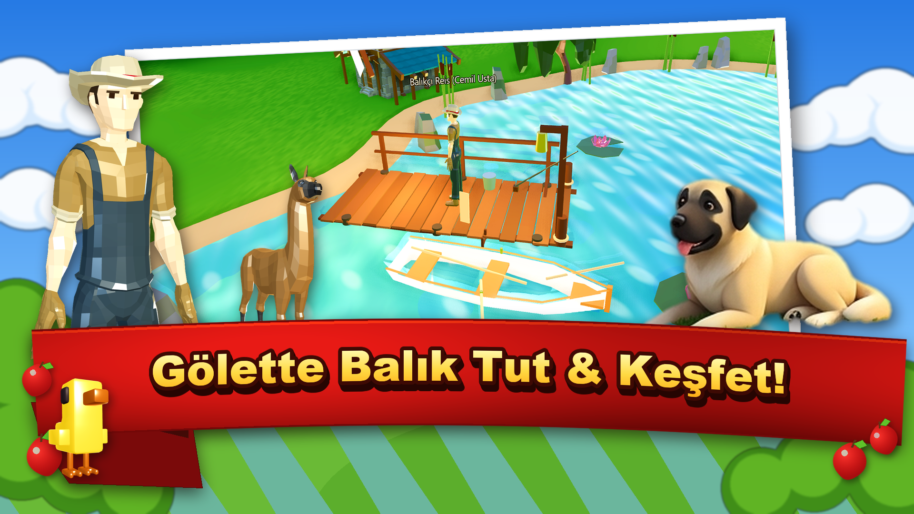
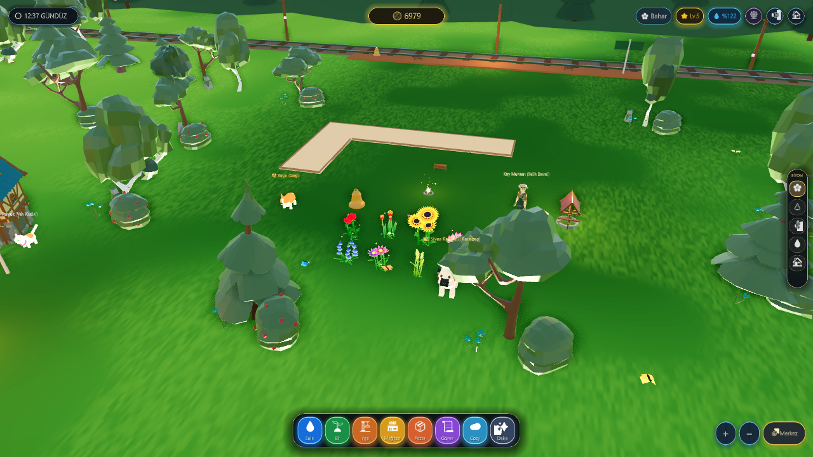
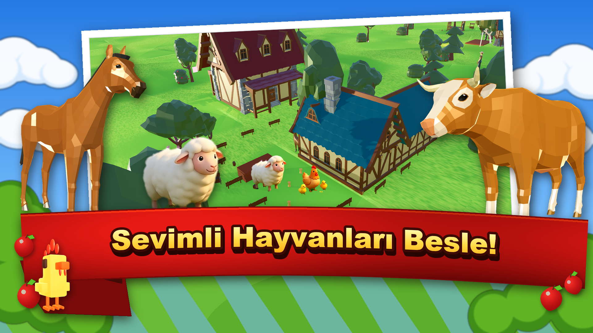
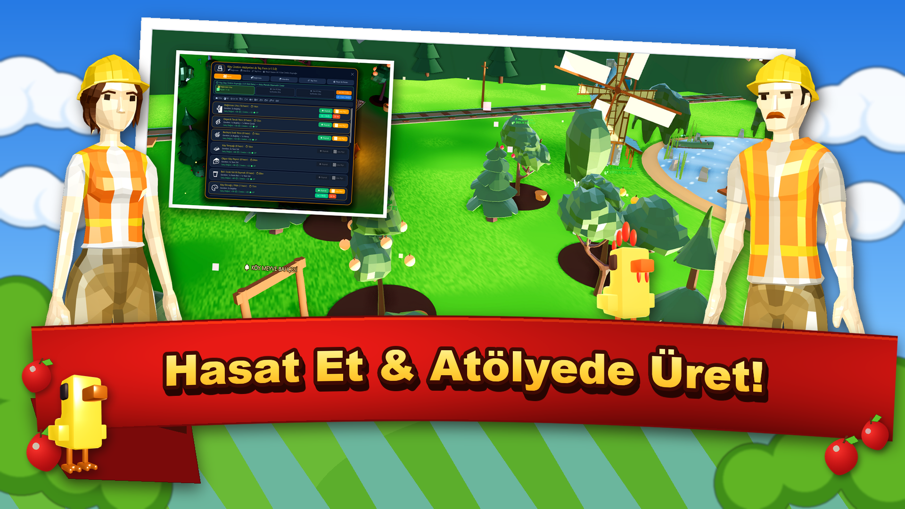
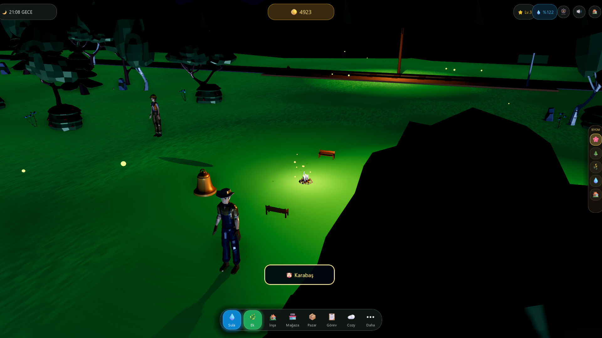

  

  # 🌱 Sanal Bahçe

  ### 3D Huzurlu Çiftlik, Otantik Köy Hayatı ve Doğa Simülasyonu

  [-34d399?style=for-the-badge&logo=android)](https://batuhanklcky.github.io/sanalbahce/anasayfa.html)
  
  
  
  

  

    <b>Toprağın kokusunu hisset, tohum ek, hayvanlarını sev, taş fırında köy ekmeği pişir ve otantik bir Anadolu köyünün huzur dolu atmosferinde dinlen.</b>
  

  

    
    
  

---

  

---

## 🌟 Oyun Hakkında

**Sanal Bahçe**, modern hayatın gürültüsünden ve stresinden uzaklaşıp doğanın huzurlu ritmine adım atmanızı sağlayan, **A+ kalite görsel ve dokunsal geri bildirimlere** sahip 3D bir çiftlik ve köy simülasyonudur.

Reklam baskısından ve yapay süre kısıtlamalarından uzak; tohumdan hasada, kümesten taş fırına, köy pazarından sakin gölet balıkçılığına kadar uzanan zengin ve organik bir üretim döngüsü sunar.

---

## 🎮 Öne Çıkan Özellikler

### 🎣 1. Gerçekçi 3D Gölet Balıkçılığı & Çekme Mekaniği (v3.7.2)
* **Dokunsal Jestle Atış (Gesture Casting):** Düz buton basma mekaniği kaldırıldı; ekranda parmağınızı geriye çekerek kamış gerilimini ayarlayın, bırakarak şamandırayı göle fırlatın!
* **Dinamik Bükülen 3D Olta Kamışı:** Bambu/karbon olta kamışı atış yaparken geriye, balık çırpınırken öne ve aşağıya fiziksel eğrilikle bükülür.
* **Fiziksel Yüzen Şamandıra & Su Halkaları:** Klasik kırmızı-beyaz mantar şamandıra göl suyunda sinüs dalgalarıyla salınır ve etrafına genişleyen eşmerkezli su halkaları (ripples) yayar.
* **Su Altı Balık Silüeti & Tasmala Hissi:** Şamandıranın etrafında yüzen gölge balık silüeti yemi yoklar; aniden batınca yukarı kaydırarak veya dokunarak tasmala refleksi verilir.
* **Etkileşimli Pirinç Balıkçı Makarayı Çevirme (Interactive Brass Reel):** Ekranda parmağınızı dairesel çevirerek sardığınız nostaljik pirinç makara, her turda mekanik tıkırtı (ratchet click) sesleri ve mikro-titreşimler üretir.
* **Misina Gerilim Mücadelesi:** Balığın ani çırpınışlarına karşı gerilim ibresini yeşil alanda tutarak misinayı koparmadan kıyıya çekin.
* **Havaya Sıçrayan 3D Balık:** Kıyıya varıldığında su damlacıkları saçarak havaya sıçrayan balık kutlama kartında boy (cm) ve ağırlık (kg) değerleriyle sergilenir.

### 🏡 2. Huzurlu Çiftlik Evi İçi & Oda Dekorasyonu (v3.7.2)
* **3D Çiftlik Evi İçi:** Çiftlik evinin kapısına dokunulduğunda doğrudan sıcacık 3D oda perspektifine girilir.
* **Çıtırdayan Taş Şömine:** İçinde meşe odunları yanan, yukarıya kıvılcımlar saçan ve odanın içini aydınlatan titrek ışıklı şömine. Şömineye odun atarak +20 Enerji kazanın.
* **Kuzine & Taze Çiftlik Çayı:** Kuzinenin üzerinde fokurdayan bakır çaydanlıktan taze demlenen çiftlik çayını yudumlayarak +15 Enerji ve +25 XP kazanın.
* **Nostaljik Pikap (Gramofon):** Dönen siyah plağı ve pirinç borusuyla akustik köy ezgilerini dinleyin.
* **Sallanan Sandalye:** Sürekli ahenkle salınan ahşap koltukta dinlenin.
* **Balıkçı Trofe Duvarı:** Göletten yakaladığınız en büyük Alabalık, Sazan ve Altın Sazan rekorları şömine üstündeki ahşap plakalarda gururla sergilenir.
* **Oda Halısı Özelleştirme:** Anadolu Dokuma Kilimi, Bohem Peluş Yün Halı ve Doğal Ayı Postu arasında anında geçiş yapın; tercihiniz oyuna kaydedilir.

### 🌿 3. Rastgele Ton Varyasyonları & Doğal Çevre Uyumu (v3.7.1)
* **Shader Seviyesinde Organik Renk Varyasyonları:** Çimen ve taş modellerine dünya koordinatı bazlı deterministik hash üzerinden Hue (ton), Doygunluk ve Parlaklık değişimleri atanarak hiçbir modelin yapay bir kopya gibi durmaması sağlandı.
* **Doğal Çevre Uyumu & Yumuşak Zemin Geçişleri:** Gölet kıyıları, köy pazarı ve tarlalar arasındaki keskin poligon hatları organik gürültü maskelemesiyle eritilerek toprağın bitkiler ve kumla kusursuz bir şekilde kaynaşması sağlandı.
* **Kıyı & Meydan Dokusu:** Gölet çevresinde kumsal ve nehir silti saçakları, köy meydanında çiğnenmiş toprak ayak izleri çim zemine doğal olarak yedirildi.

### 🪨 2. PBR Doğal Toprak & Taş Dokuları, Çatlaklar ve Işık Kırılmaları (v3.7.0)
* **Gerçekçi PBR Fiziksel Materyaller:** Düz plastik renk boyası görünümü tamamen kaldırılarak toprak, tarlalar, kayalar ve taşlara yüksek çözünürlüklü Normal Map (çatlak/pürüz kabartması) ve Roughness (matlık/parlaklık varyasyonu) haritaları entegre edildi.
* **Taş Kenarlarında Işık Sekmesi (Fresnel Rim Lighting):** Güneş ve gökyüzü ışığının taşların, kayaların, arnavut kaldırımı yolların ve bordürlerin keskin kenarlarından ve kıvrımlarından hafifçe sekmesi sağlanarak derinlik ve gerçekçilik katbekat artırıldı.
* **Organik Tarla & Toprak Dokusu:** Çiftlik tarlaları artık nemli gözenekler, kırıntı kabartmaları ve doğal Ambient Occlusion derinliğiyle zenginleşti.
* **Köy Yolları & Arnavut Kaldırımı:** Köy patikaları ayakla aşınmış taş üstü parlaklığı ile derin derz kanalları arasında kusursuz bir PBR kontrastına kavuştu.

### 🥖 2. Taş Fırın & Mutfak Pişirme Ustalığı Mini Oyunu (v3.6.9)
* **İnteraktif Hamur Yoğurma & Çırpma:** Köy mutfağında tarifleri hazırlarken dokunmatik ritmik yoğurma sistemi devreye girer; hamur hazır olunca taş fırına sürülür.
* **Taş Fırın Altın Kıvam İbresi:** Salınan sıcaklık ibresini 'Altın Kıvam' bölgesinde yakalayıp fırından çekerek kusursuz çıtırlıkta yemekler pişirin.
* **Şef Yıldızları & 2x Ödül:** ⭐⭐⭐ Kusursuz Şef derecesi alan yemekler 2 kat ürün adedi, ekstra XP ve altın bonusu kazandırır.
* **Hızlı Pişir Kolaylığı:** Vakti olmayan oyuncular için tek tıkla doğrudan pişirme ("⚡ Hızlı Pişir") seçeneği korunmuştur.

### 🏡 2. Köy Gezisi & Bahçe Ziyareti (Social Hub)
* **Örnek Köy Çiftlikleri:** Muhtar Rıza, Çiçekçi Elif, Usta Değirmenci ve Huzur Vadisi gibi zengin yerleşimli çiftlikleri 3D olarak gezin ve ilham alın.
* **Posta Kutusu Bereket Hediyesi:** Ziyaret edilen çiftliğin posta kutusuna tek dokunuşla bereket hediyesi bırakarak hem dostluk kurun hem de +50 🟡 altın ve XP kazanın.
* **Bahçe Kodu Paylaşımı & İçe Aktarma:** Kendi çiftlik yerleşiminizi tek tıkla şifreli metin kodu olarak kopyalayabilir, arkadaşlarınızla paylaşabilir veya onların kodunu yapıştırarak bahçelerini ziyaret edebilirsiniz.
* **Kaygısız Geri Dönüş:** Geziyi tamamlayıp kendi bahçenize döndüğünüzde mevcut tüm binalarınız, hayvanlarınız ve tarlalarınız eksiksiz korunur.

### ⚡ 3. Hızlı Dokunmatik Ekim, Hasat & Pazar (v3.6.8)
* **Gecikmesiz Anında Dokunmatik Ekim:** Tohum seçip tarlaya dokunduğunuzda ekin hemen yerleşir; olgunlaşan ekinlere veya susamış mahsullere dokunulduğunda anında hasat edilir ve sulanır.
* **Genişletilmiş Meyve Ağacı Hasadı:** Ağaç silkeleme ve meyve toplama etkileşim mesafesi 4.8 metreye genişletildi, ağaç dallarına, sepetine veya gövdesine dokunulduğunda sepet anında dolar.
* **Köy Pazarı & Toplu Satış:** Köy tezgâhında artık hem 1x Sat hem de 'Tümünü Sat' butonları aktif. Çantadaki tüm ekinler, meyveler, bal ve lezzetler tek tıkla altın kazandırır.
* **Ticaret Treni ve İstasyon İskele Algılayıcı:** Ray hattı ve istasyon peronunun tamamına dokunmatik algılama eklendi, tren geldiğinde doğrudan ticaret menüsü açılır.
* **İnşa Modu Minyatür Model Düzeltmeleri:** Fıçı, sandık, saman balyası, çuval, kargo paketi, kazan, kamp ateşi, çan ve sokak feneri modelleri gerçek boyutlarına (1.60 - 1.85x) büyütüldü.
* **Dinamik Eğitim Bildirimleri:** Bildirim toast kutucuğu eğitim adımlarının altına yerleştirilerek ekran metinlerinin çakışması engellendi.

### 🧑‍🌾 2. Akıllı Çiftçi Komuta & İş Bölümü
* **Oyuncu Emirli Hareket:** Çiftçi yardımcıları (Mehmet & Ayşe) artık rastgele hareket etmez; tamamen sizin verdiğiniz emirler doğrultusunda ayrı ayrı tarlalara koşar.
* **Canlı Baş Üstü Durum Levhaları:** Çiftçilerin ne yaptığı başlarının üzerindeki 3D panolardan anlık olarak okunur (`Tohum Ekiyor 🌱`, `Sulamaya Gidiyor 💧`, `Hasada Gidiyor 🌾`, `Emir Bekliyor 🧑‍🌾`).
* **Otomatik Görev Sırası (Queue):** Peş peşe verilen işler sıraya alınır; işi biten çiftçi kulübeye dönmeden doğrudan sıradaki tarlaya yönelir.

### 💧 2. Toprak Nemi Mekaniği & Dengeli Tarım Süreleri (v3.6.8)
* **Toprak Kuruma Zamanlayıcısı:** Ekinlerin toprağı zamanla kurur ve üzerinde mavi `💧 Su Bekliyor` rozeti belirir.
* **Sulama ile 2x Hızlı Büyüme:** Sulanan ekinler parıldayan su damlacıkları eşliğinde 2 kat daha hızlı büyür.
* **Bereketli Yağmur:** Yağmurlu günlerde doğa tarlalarınızdaki tüm ekinleri otomatik olarak can suyuyla sular.
* **Gerçekçi Süre Dengesi:** Ekinler 2 dk ile 35 dk arasında kademeli sürelerle büyür ve yüksek altın/XP kazandırır.

### 🏛️ 3. Büyük Mimari Ölçek Revizyonu (v3.6.8)
* **İnsan Oranlarına Uyumlu Binalar:** İnşa modundaki köy hanı, ahşap konaklar, değirmen, demirci ve ahırlar gerçekçi mimari oranlara (`1.45 - 1.80x`) yükseltildi.
* **Gerçekçi Bahçe Çitleri:** Çitler ve taş bahçe duvarları bel hizasına (`1.20x`) çıkarıldı.
* **Dinamik İnşa Halkası:** Yerleştirilen yapının taban alanına göre otomatik genişleyen zemin yerleşim çemberi.

### 🌾 4. Organik Botanik Çeşitlilik & Hasat
* **Zengin Botanik Çeşitlilik:** Buğday, havuç, domates, kadife gül, zarif lale, altın ayçiçeği ve kutsal nilüfer gibi kademeli seviye ekinleri.
* **Offline Büyüme (Oyun Kapalıyken İlerleme):** Oyundan çıksanız bile ekinleriniz arka planda gerçek zamanlı büyümeye devam eder.
* **İnteraktif Sulama & Bakım:** Ekinlerinizi sulayarak ve özen göstererek büyüme sürelerini hızlandırın.

### 🐔 2. Hayvan Bakımı & Mandıra İşleme
* **Tavuk Kümesi:** Tarladan hasat ettiğiniz buğdayla tavukları besleyin, 3 dakika boyunca **2x hızlı yumurtlama** ile taze köy yumurtaları toplayın.
* **Ahır Hayvanları (İnek & Alpaka):** Yemleme, sulama ve fırçalayarak sevme mekaniği. Yüksek mutlulukta **Kremamsı Süt** ve nadir **✨ Altın Süt** sağımı.
* **Köy Mandırası:** Sütten yayıkta **🧈 Köy Tereyağı**, **🧀 Taş Baskı Köy Peyniri** ve **👑 Altın Gravyer** üretimi.

### 🥖 3. Taş Fırın & Köy Mutfağı
* **Zanaat Pişirme:** Hasat edilen ürünleri mutfakta birleştirerek leziz köy tarifleri pişirin:
  * 🥖 *Köy Ekmeği / Pide* (Buğday)
  * 🍳 *Köy Omleti* (Yumurta + Domates)
  * 🥧 *Sebzeli Çıtır Börek* (Yumurta + Biber)
  * 🍰 *Çilekli Köy Pastası* (Çilek + Yumurta + Buğday)

### 📜 4. Köy Sipariş Panosu & Günlük Görevler
* **Karakter Odaklı Müşteriler:**
  * **👨‍🍳 Fırıncı Ahmet:** Sabah çörekleri için buğday, un ve fırında pişmiş taze köy ekmeği.
  * **🍳 Aşçı Cemil Usta:** Köy kahvaltısı için domates, yumurta, omlet ve köy peyniri.
  * **👴 Muhtar Rıza Bey:** Köy ambarı için buğday, süt, tereyağı ve kışlık erzak.
  * **👩‍🌾 Çiçekçi Elif:** Kadife güller, bahar çiçekleri ve taze petek balı.
  * **👨‍🌾 Manav Hasan:** Pazar tezgahı için çıtır tarla sebzeleri.
* **Dinamik Günlük Görevler:** Seviyenize göre her gün yenilenen görevlerle altın ve seviye (XP) ödülleri.

### 🏡 5. Yaşayan Otantik Anadolu Köyü
* **Otantik Mimari & Mekanlar:** Köy çardağı (kameriye), tarihi demirci atölyesi, köy fırını, değirmen ve çitli avlularıyla sevimli köy evleri.
* **Meydan Kamp Ateşi & Gece Fenerleri:** Akşam saatlerinde köyü sıcacık altın sarısı tonlarla aydınlatan lambalar ve çıtırdayan kamp ateşi.
* **Gezinen Köylüler & Canlı Pazar:** Kendi günlük rutinlerinde köy yollarında dolaşan ve tezgahlardan alışveriş yapan yerel sakinler.

### 🎣 6. Organik Gölet & Sakin Balıkçılık
* Derinlik basenli organik gölet, demirlemiş ahşap kayık, su nilüferleri ve sazlıklar.
* İskelede balık tutma mini oyunu ve huzur veren su dalgalanma shader efektleri.

### 📳 7. AAA Dokunsal (Haptic) & Ses Deneyimi
* Hasat, sağım, yumurta toplama, pişirme ve sipariş teslimlerinde cihaz titreşimiyle **dokunsal geri bildirim (Haptics)**.
* Boyutu %80 küçültülmüş, kristal netliğinde optimize **OGG Vorbis ses mimarisi**.
* Sabit **60 FPS** performans ve Android ekran çentiklerine tam uyumlu **Güvenli Alan (Safe Area)** desteği.

---

## 📸 Ekran Görüntüleri

  <table>
    <tr>
      <td width="50%">
        
        
<b>🏪 Canlı Köy Pazarı & Çarşısı</b>

      </td>
      <td width="50%">
        
        
<b>🎣 Organik Gölet & Balıkçı İskelesi</b>

      </td>
    </tr>
    <tr>
      <td width="50%">
        
        
<b>💎 Kristal Netliğinde Responsive Arayüz</b>

      </td>
      <td width="50%">
        
        
<b>🐔 Canlı Kümes & Çiftlik Hayvanları</b>

      </td>
    </tr>
    <tr>
      <td width="50%">
        
        
<b>🌾 Çalışan Yel Değirmeni & Tarlalar</b>

      </td>
      <td width="50%">
        
        
<b>🔥 Meydan Kamp Ateşi & Gece Işıkları</b>

      </td>
    </tr>
  </table>

---

## 🛠️ Teknoloji ve Mimari

| Katman | Teknoloji / Kütüphane | Açıklama |
|---|---|---|
| **Oyun Motoru** | Godot Engine 4.x | Forward+ & Mobile GL uyumlu modern 3D mimari |
| **Hedef Platform** | Android Native (AAB / APK) | Android 8.0 - 15+ (API 26-36) tam uyumluluk |
| **Görsel & Render** | ACES Tone Mapping + Özel Shaders | Doygun çim zemin, su kırılması, rüzgar dalgalanması |
| **Ses & Titreşim** | OGG Vorbis + Android Haptics | Düşük bellek tüketimli ses motoru ve dokunsal geri bildirim |
| **Kayıt Sistemi** | Atomik Çift Yedekli Yerel Depolama | Veri kaybını engelleyen güvenli `save_game.json` sistemi |
| **Stüdyo Portalı** | HTML5 / Modern CSS / Vanilla JS | Stüdyo vitrini ve tanıtım sayfası |

---

## 🏢 Stüdyo & Geliştirici

Bu proje, bağımsız oyun ve yazılım teknolojileri stüdyosu **[77x Technologies](https://batuhanklcky.github.io/77xTechnology/)** tarafından geliştirilmektedir.

* **Geliştirici:** Batuhan Kılıçkaya
* **Resmi Web Sitesi:** [batuhanklcky.github.io/sanalbahce/anasayfa.html](https://batuhanklcky.github.io/sanalbahce/anasayfa.html)
* **Stüdyo Sayfası:** [batuhanklcky.github.io/77xTechnology](https://batuhanklcky.github.io/77xTechnology/)
* **LinkedIn:** [linkedin.com/in/batuhanklcky](https://www.linkedin.com/in/batuhanklcky/)
* **GitHub:** [@BatuhanKlcky](https://github.com/BatuhanKlcky)

---

## 📄 Lisans

Bu proje [MIT Lisansı](LICENSE) kapsamında açık kaynak olarak paylaşılmaktadır.
