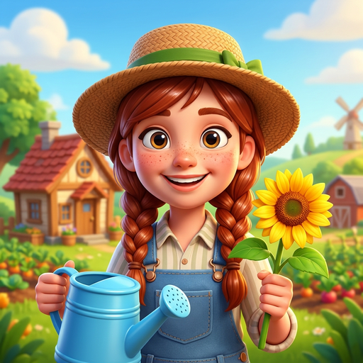
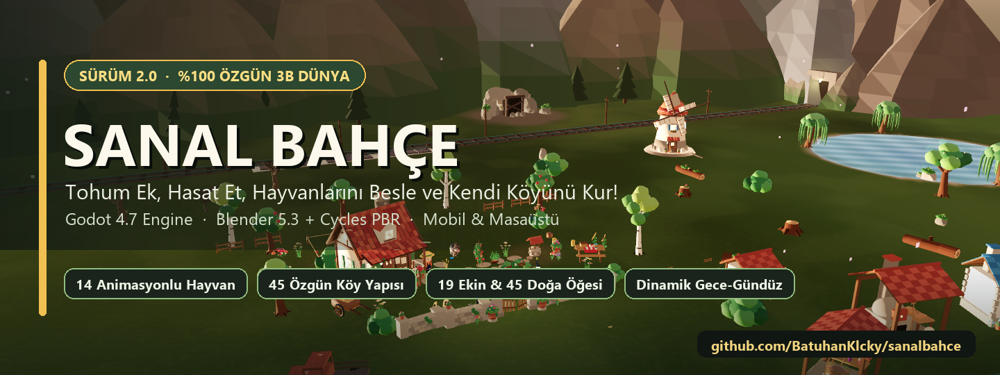
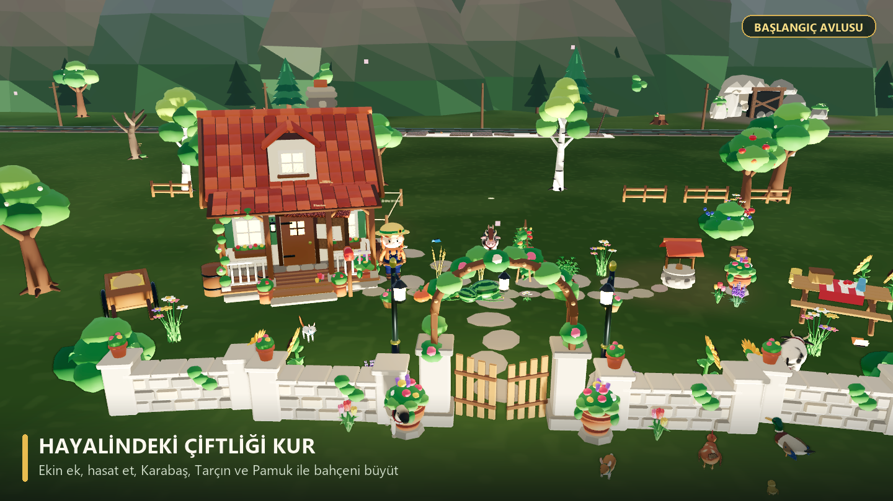
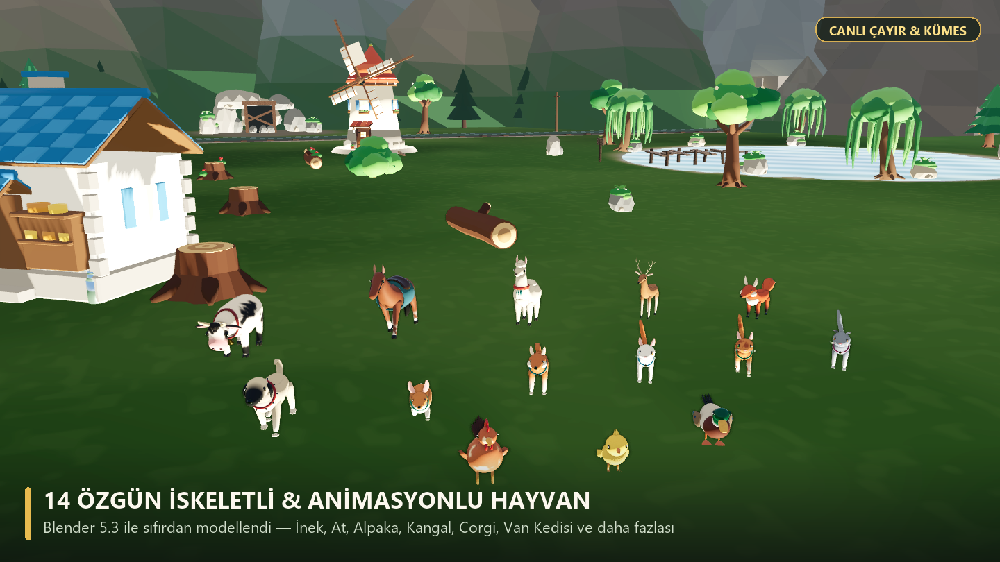
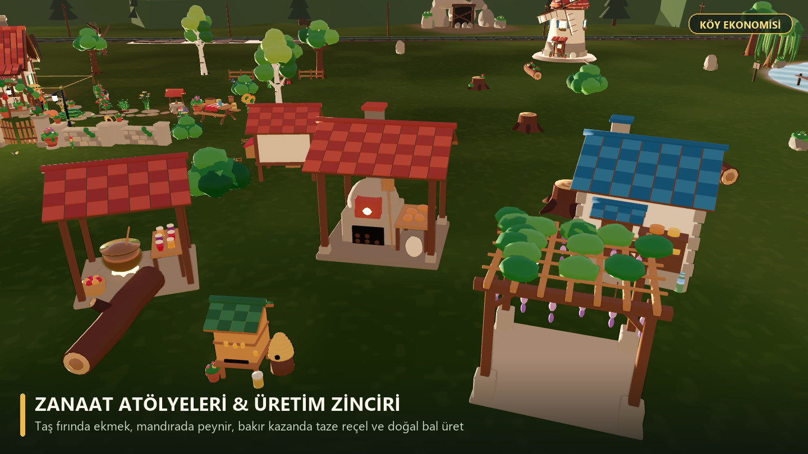
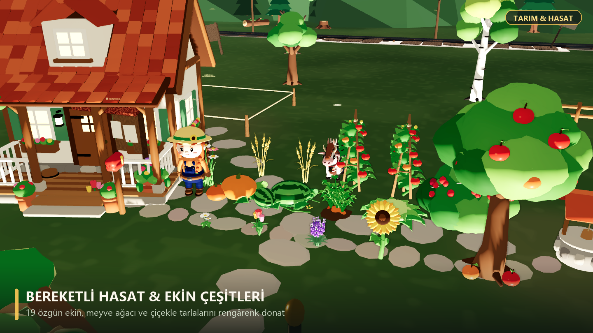
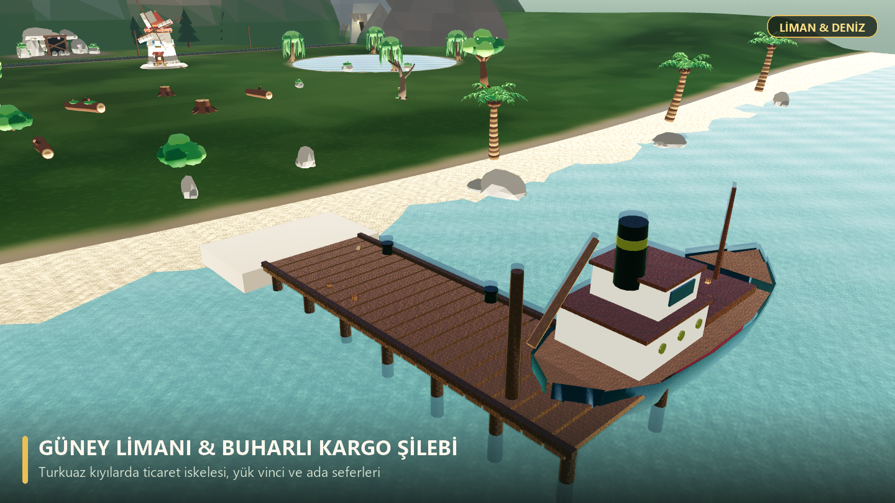
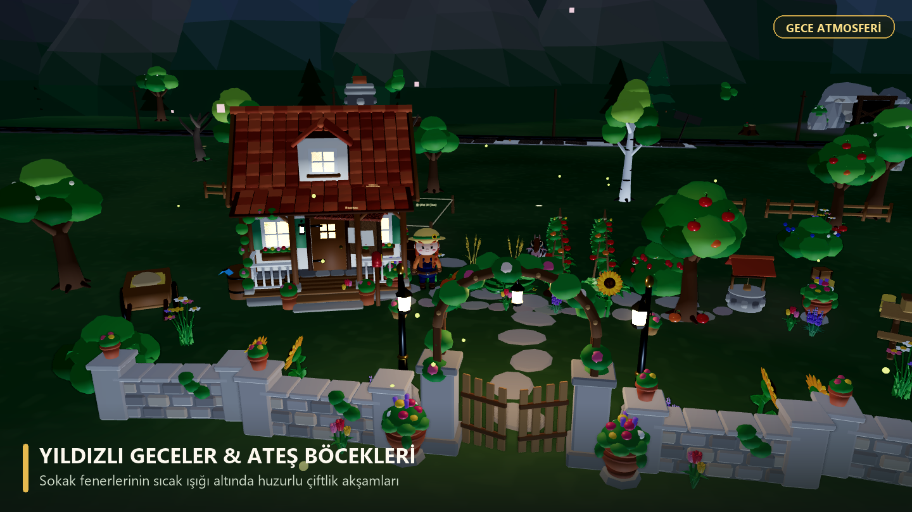
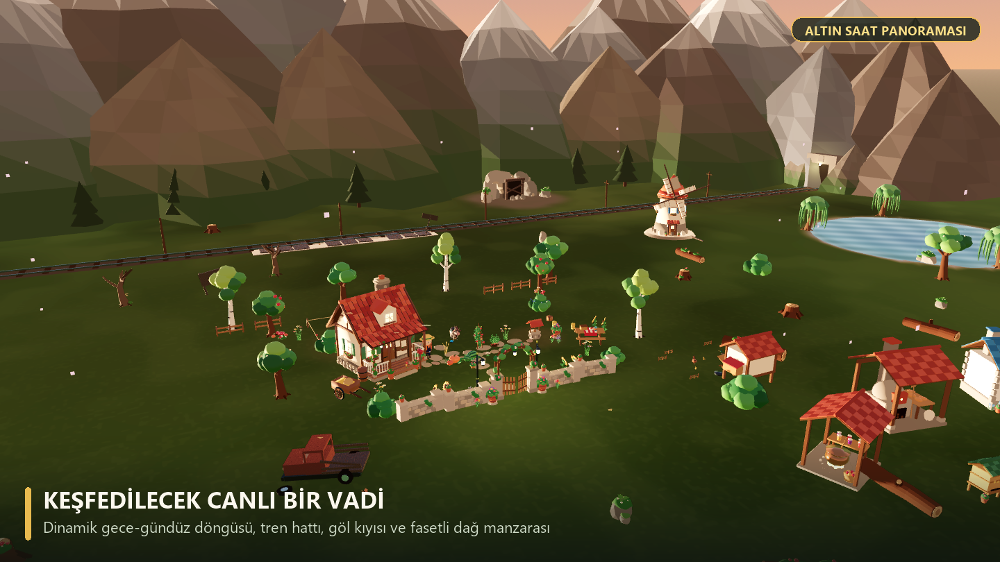
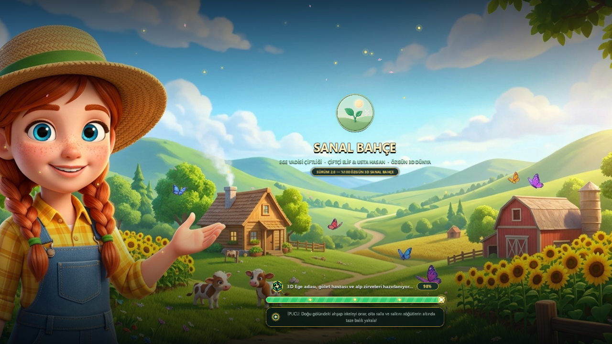



  

  # 🌾 Sanal Bahçe (v2.0)

  ### %100 Özgün 3D Huzurlu Çiftlik, Zanaat & Ada Yaşamı Simülasyonu

  [-34d399?style=for-the-badge&logo=android)](https://batuhanklcky.github.io/sanalbahce/anasayfa.html)
  
  
  
  
  

  

    <b>Toprağın kokusunu hisset, tohum ek, hayvanlarını sev, taş fırında köy ekmeği pişir ve tamamen sıfırdan modellenmiş otantik Anadolu köyünün huzurlu atmosferinde dinlen.</b>
  

  

    
    
  

---

  

---

## 📸 Oyun İçi Görüntüler (v2.0)

  <table>
    <tr>
      <td width="50%">
        
        
<b>🏡 Çiftlik Evi, Başlangıç Avlusu & Evcil Dostlar</b>

      </td>
      <td width="50%">
        
        
<b>🐄 14 Özgün İskeletli & Animasyonlu Hayvan</b>

      </td>
    </tr>
    <tr>
      <td width="50%">
        
        
<b>🥖 Zanaat Atölyeleri (Reçel, Fırın, Mandıra & Bal)</b>

      </td>
      <td width="50%">
        
        
<b>🌾 Bereketli Hasat & 19 Özgün Ekin Çeşidi</b>

      </td>
    </tr>
    <tr>
      <td width="50%">
        
        
<b>🚢 Güney Limanı & Buharlı Kargo Şilebi</b>

      </td>
      <td width="50%">
        
        
<b>✨ Yıldızlı Geceler & Ateş Böcekleri</b>

      </td>
    </tr>
    <tr>
      <td width="50%">
        
        
<b>⛰️ Altın Saat Vadi, Göl & Fasetli Dağ Panoraması</b>

      </td>
      <td width="50%">
        
        
<b>🌟 Sürüm 2.0 Açılış & Yükleme Ekranı</b>

      </td>
    </tr>
  </table>

---

## 🌟 Oyun Hakkında

**Sanal Bahçe**, modern hayatın gürültüsünden ve stresinden uzaklaşıp doğanın huzurlu ritmine adım atmanızı sağlayan, **%100 özgün 3D modellere ve dokulara** sahip bir çiftlik ve köy simülasyonudur.

Reklam baskısından ve yapay süre kısıtlamalarından uzak; tohumdan hasada, kümesten taş fırına, güney limanından sakin göl balıkçılığına kadar uzanan zengin ve organik bir üretim döngüsü sunar.

---

## ✨ v2.0 Yenilikleri & Öne Çıkan Özellikler

### 🎨 1. %100 Özgün Blender 5.3 + Cycles PBR Varlık Kütüphanesi
* **14 İskeletli & Animasyonlu Hayvan:** İnek (`Cow`), Alpaka (`Alpaca`), At (`Horse`), Geyik (`Deer`), Tilki (`Fox`), Tavuk (`Chicken`), Civciv (`Chick`), Ördek (`Duck`), Sivas Kangalı / Karabaş (`Dog`), Corgi / Tarçın (`Dog_Corgi`), Shiba (`Dog_Shiba`), Van Kedisi / Pamuk (`Cat_Van`), Tekir (`Cat`) ve Scottish Fold (`Cat_Fold`).
* **Canlı Animasyon Sistemi:** Tüm dört ayaklılarda `Idle`, `Walk`, `Run`, `Eating`; kanatlılarda ek `Attack` (kanat çırpma) ve yemleme/sevme etkileşimlerine özel tepki animasyonları.
* **45 Özgün Köy Binası & İnşa Yapısı:** Çiftlik Evi, Taş Fırın, Mandıra, Reçel Atölyesi, Arı Kovanı, Tavuk Kümesi, Değirmen, Ahır, Demirci, Han, Kemerli Gül Kapısı, Bahçe Duvarları, Sokak Fenerleri ve Pergola.
* **19 Ekin / Çiçek / Mantar & 45 Doğa Öğesi:** Kaydırmalı ekim/hasat, meyve ağaçları, kayalar ve yosunlu kütükler.

### ⛰️ 2. Şekillendirilmiş Ada Arazisi & Göz Yormayan Renk Paleti
* `TerrainMeshBuilder` ile tek draw-call'da üretilen 3D ada yüzeyi, doğu göl havzası, güney kumsalı ve fasetli dağ silsilesi.
* Göz yormayan yumuşatılmış pastel ışıklandırma, dinamik gece-gündüz döngüsü ve mevsim/hava durumu paletleri.

### 🎣 3. Gerçekçi 3D Balıkçılık, Çiftlik Evi İçi & Köy Ekonomisi
* **Jestle Atış & Etkileşimli Pirinç Makara:** Parmağınızı geriye çekerek şamandırayı göle fırlatın, misina gerilimini kontrol ederek balığı kıyıya çekin.
* **3D Çiftlik Evi İçi:** Çıtırdayan taş şömine, kuzine üzerinde demlenen çay, nostaljik gramofon ve sallanan sandalye.
* **Köy Siparişleri & Güney Limanı:** Köy sakinlerinin günlük siparişlerini karşılayın, buharlı kargo şilebi ile deniz aşırı ticaret yapın.

---

## 🛠️ Teknoloji ve Mimari

| Katman | Teknoloji / Kütüphane | Açıklama |
|---|---|---|
| **Oyun Motoru** | Godot Engine 4.7.2 | GL Compatibility / Mobile uyumlu modern 3D mimari |
| **3D Modelleme & Bake** | Blender 5.3 + Cycles | %100 özgün heykelsi modeller, vertex-weight rig ve baked PBR dokular |
| **Hedef Platform** | Android Native (AAB / APK) & Masaüstü | Android 8.0 - 15+ (API 26-36) tam uyumluluk |
| **Görsel & Render** | ACES Tone Mapping + Özel Shaders | Çok katmanlı arazi splatting, su kırılması, yumuşatılmış pastel palet |
| **Ses & Titreşim** | OGG Vorbis + Android Haptics | Düşük bellek tüketimli ses motoru ve dokunsal geri bildirim |
| **Kayıt Sistemi** | Atomik Çift Yedekli Yerel Depolama | Veri kaybını engelleyen güvenli `save_game.json` sistemi |

---

## 🏢 Stüdyo & Geliştirici

Bu proje, bağımsız oyun ve yazılım teknolojileri stüdyosu **[77x Technologies](https://batuhanklcky.github.io/77xTechnology/)** tarafından geliştirilmektedir.

* **Geliştirici:** Batuhan Kılıçkaya
* **Resmi Web Sitesi:** [batuhanklcky.github.io/sanalbahce/anasayfa.html](https://batuhanklcky.github.io/sanalbahce/anasayfa.html)
* **Stüdyo Sayfası:** [batuhanklcky.github.io/77xTechnology](https://batuhanklcky.github.io/77xTechnology/)
* **LinkedIn:** [linkedin.com/in/batuhanklcky](https://www.linkedin.com/in/batuhanklcky/)
* **GitHub:** [@BatuhanKlcky](https://github.com/BatuhanKlcky)

---

## 📄 Lisans

Bu proje [MIT Lisansı](LICENSE) kapsamında açık kaynak olarak paylaşılmaktadır.
