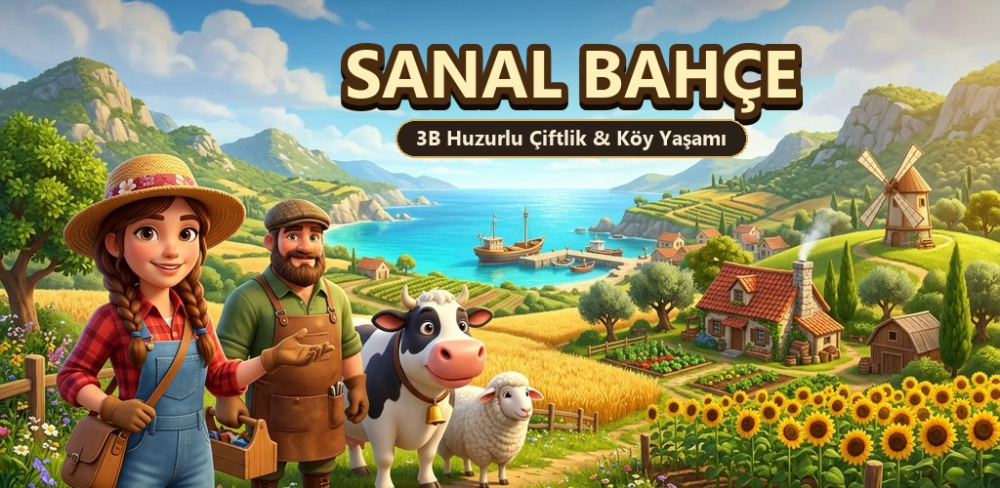
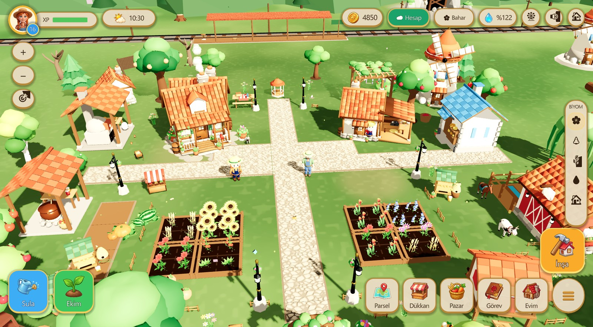
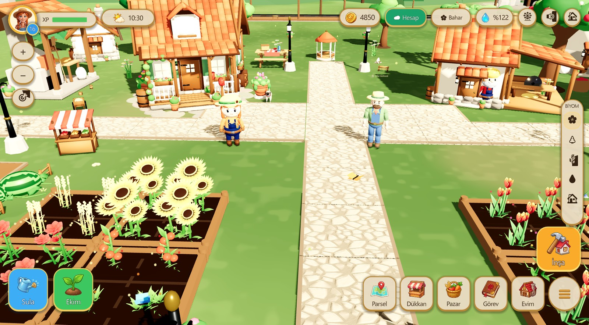
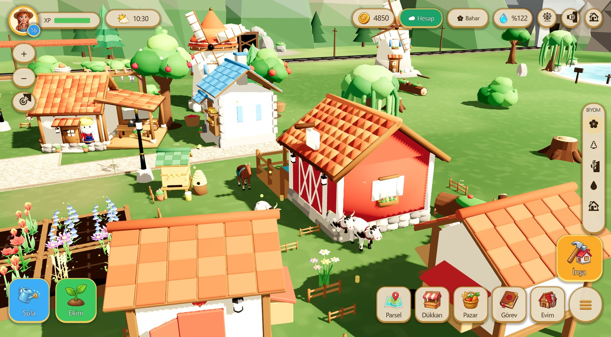
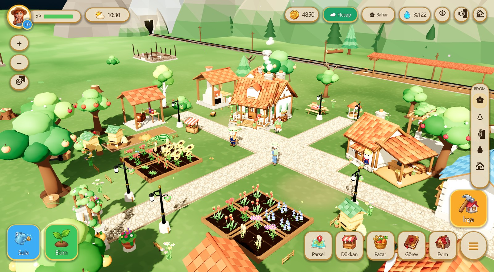
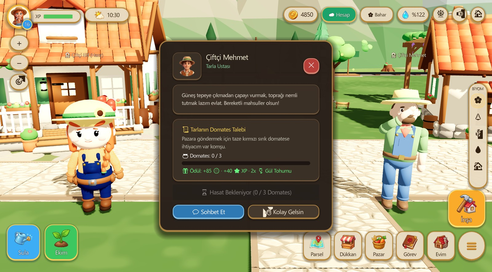
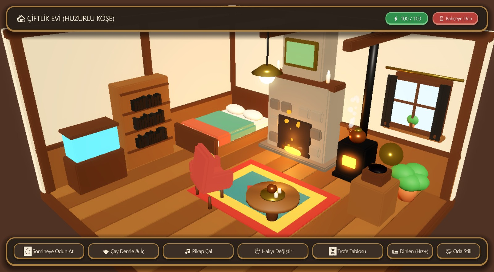



  

  # 🌾 Sanal Bahçe (v2.1.0)

  ### %100 Özgün 3D Huzurlu Çiftlik, Zanaat & Köy Yaşamı Simülasyonu

  [-34d399?style=for-the-badge&logo=android)](https://batuhanklcky.github.io/sanalbahce/anasayfa.html)
  
  
  
  
  

  

    <b>Toprağın kokusunu hisset, tohum ek, can suyu ver, hayvanlarını besle, taş fırında köy ekmeği pişir ve tamamen sıfırdan modellenmiş otantik Anadolu köyünün huzurlu atmosferinde dinlen.</b>
  

  

    
    
    
  

---

  

---

## 📸 Oyun İçi Görüntüler (v2.1.0)

  <table>
    <tr>
      <td width="50%">
        
        
<b>🏡 Panoramik 3B Çiftlik Üssü, Taş Yollar & Atölyeler</b>

      </td>
      <td width="50%">
        
        
<b>🌻 Gerçek Sulama Mekaniği, Rengârenk 3B Ekinler & Bahçeler</b>

      </td>
    </tr>
    <tr>
      <td width="50%">
        
        
<b>🐄 Büyükbaş Ahırı, Tavuk Kümesi, Arı Kovanları & Yel Değirmeni</b>

      </td>
      <td width="50%">
        
        
<b>🥖 Taş Fırın, Reçel Kazanı, Marangoz Kulübesi & Meyve Bahçesi</b>

      </td>
    </tr>
    <tr>
      <td width="50%">
        
        
<b>👨‍🌾 Yeni 3B Çiftçi Mehmet, Çiftçi Elif & Köy Görevleri</b>

      </td>
      <td width="50%">
        
        
<b>🔥 Şömineli Sıcak 3B Çiftlik Evi İç Mekânı & Özelleştirme</b>

      </td>
    </tr>
  </table>

---

## 🌟 Oyun Hakkında

**Sanal Bahçe**, modern hayatın gürültüsünden ve stresinden uzaklaşıp doğanın huzurlu ritmine adım atmanızı sağlayan, **%100 özgün 3D modellere, dokulara ve stüdyo seslerine** sahip bir çiftlik ve köy simülasyonudur.

Reklam baskısından ve yapay süre kısıtlamalarından uzak; tohumdan hasada, sulamadan taş fırına, mandıradan sakin göl balıkçılığına kadar uzanan zengin ve organik bir üretim döngüsü sunar.

---

## ✨ v2.1.0 (Build 84) Yenilikleri & Öne Çıkan Özellikler

### 👨‍🌾 1. Yeni 3B Karakter — Çiftçi Mehmet & Canlı Köy Sakinleri
* **Blender 5.3 ile Sıfırdan Modellenmiş Çiftçi Mehmet (`CiftciMehmet.glb`):** Hasır şapkası, kırmızı fuları, kot tulumu ve yerleşik `Idle` / `Walk` / `Run` / `Wave` animasyonlarıyla artık ayrı bir 3B karakter olarak çiftlikte!
* **Usta Hasan & Çiftçi Elif Düzeltmeleri:** Tüm köy karakterleri kendi 3B portreleri, doğru isimleri ve günlük görevleriyle kusursuz çalışır.

### 💧 2. Gerçek Sulama Mekaniği & Dengeli Büyüme Süreleri
* **Can Suyu Olmadan Büyüme Durur:** Yeni ekilen tohumlar kuru toprakla ve `💧 Sula! (Durdu)` rozetiyle başlar; sulandığında toprak koyulaşır, ilk 25 saniyede **+%25 taze su hız bonusu** kazanır ve 90 saniye boyunca nemli kalır.
* **Yağmur Etkileşimi & Yeni Büyüme Ritmi:** Yağmurlu havalarda tüm tarla otomatik sulanır. Ekin büyüme süreleri daha keyifli bir tarım temposu için uzatıldı (`Buğday 90 sn` – `İmparator Nilüferi 9 dk`).

### 🪵 3. Göz Yormayan Ceviz-Altın Arayüz & Mobil Konfor
* **Parlamasız Sıcak Palet:** Beyaz parlama yapmayan koyu ceviz (`#2A211B`) ve antik altın paneller, büyütülmüş dokunmatik butonlar.
* **Tam Ekran Menüler:** Dükkân, İnşa, Pazar, Görevler ve Mutfak pencereleri tam ekran ferah ızgara düzenine geçirildi; dokunmatik kaydırma (`TouchScrollHelper`) Android için pürüzsüzleştirildi.

### 🎵 4. %100 Özgün Rahatlatıcı Stüdyo Ses Paketi
* **35 Yeni 44.1 kHz Stereo OGG Ses:** Yumuşak gündüz & gece akustik müzikleri, kuş cıvıltıları, cırcır böcekleri, yağmur ambiyansı ve sıcak ahşap/kalimba/su efektleri. Master veriyolunda 8.8 kHz yumuşatıcı filtre ve limiter ile hiçbir ses kulak tırmalamaz.

### ⚡ 5. Dev Performans Optimizasyonu (-%94.9 Poligon · Sabit 60 FPS)
* Sahne poligon yükü **4.3M → 218K** seviyesine düşürüldü; `MultiMeshInstance3D` arazi/ateş böceği toplulaştırması ve akıllı gölge optimizasyonuyla mobil cihazlarda sabit **60 FPS** akıcılık sağlandı.

### 🎨 6. %100 Özgün 3B Varlık Kütüphanesi & Köy Ekonomisi
* **14 İskeletli & Animasyonlu Hayvan:** İnek, Alpaka, At, Geyik, Tilki, Tavuk, Civciv, Ördek, Sivas Kangalı, Corgi, Shiba, Van Kedisi, Tekir ve Scottish Fold.
* **45+ Köy Binası & Atölye:** Çiftlik Evi (içi gezilebilir), Yel Değirmeni, Taş Fırın, Mandıra, Reçel Kazanı, Arı Kovanı, Tavuk Kümesi, Ahır, Marangoz Kulübesi, Pazar Tezgâhı ve Kemerli Kapı.
* **3D Balıkçılık & Bulut Kayıt:** Parmak jestiyle olta atışı, dönen pirinç makara ve Google Play Games bulut kaydı.

---

## 🛠️ Teknoloji ve Mimari

| Katman | Teknoloji / Kütüphane | Açıklama |
|---|---|---|
| **Oyun Motoru** | Godot Engine 4.7.2 | GL Compatibility / Mobile uyumlu modern 3D mimari (60 FPS) |
| **3D Modelleme & Rig** | Blender 5.3 + Cycles PBR | %100 özgün heykelsi modeller, tek draw-call karakter rigleri |
| **Hedef Platform** | Android Native (AAB / APK) & Masaüstü | Android 8.0 – 15+ (API 26–36) tam uyumluluk · `v2.1.0` (`Build 84`) |
| **Görsel & Render** | ACES Tone Mapping + MultiMesh + Özel Shaders | -%95 poligon yükü, yumuşak ışıklandırma, dinamik mevsim & hava |
| **Ses & Titreşim** | %100 Özgün 44.1 kHz OGG Vorbis + Master LPF | Rahatlatıcı müzikler, doğa ambiyansı ve dokunsal geri bildirim |
| **Kayıt Sistemi** | Atomik Yerel Depolama & Bulut Aktarımı | Veri kaybını önleyen `save_game.json` + Google Play Games |

---

## 🏢 Stüdyo & Geliştirici

Bu proje, bağımsız oyun ve yazılım teknolojileri stüdyosu **[77x Technology](https://batuhanklcky.github.io/77xTechnology/)** tarafından geliştirilmektedir.

* **Geliştirici:** Batuhan Kılıçkaya
* **Google Play:** [Sanal Bahçe — Google Play Store](https://play.google.com/store/apps/details?id=com.batuhanklcky.sanalbahce)
* **Resmi Web Sitesi:** [batuhanklcky.github.io/sanalbahce/anasayfa.html](https://batuhanklcky.github.io/sanalbahce/anasayfa.html)
* **Stüdyo Sayfası:** [batuhanklcky.github.io/77xTechnology](https://batuhanklcky.github.io/77xTechnology/)
* **LinkedIn:** [linkedin.com/in/batuhanklcky](https://www.linkedin.com/in/batuhanklcky/)
* **GitHub:** [@BatuhanKlcky](https://github.com/BatuhanKlcky)

---

## 📄 Lisans

Bu proje [MIT Lisansı](LICENSE) kapsamında açık kaynak olarak paylaşılmaktadır.
